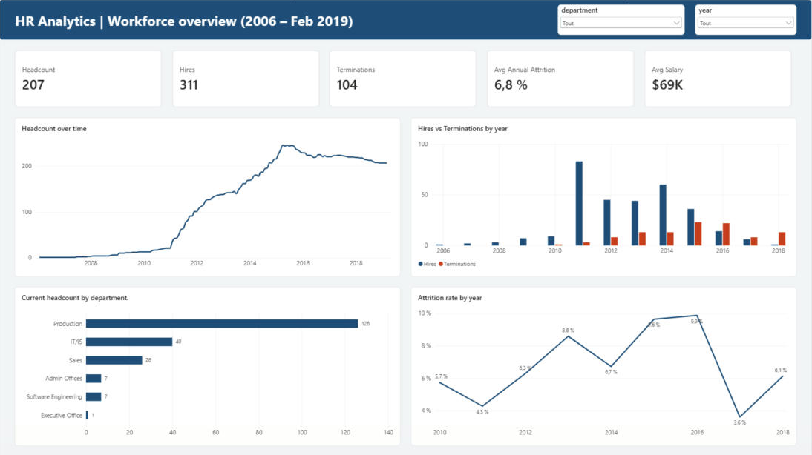
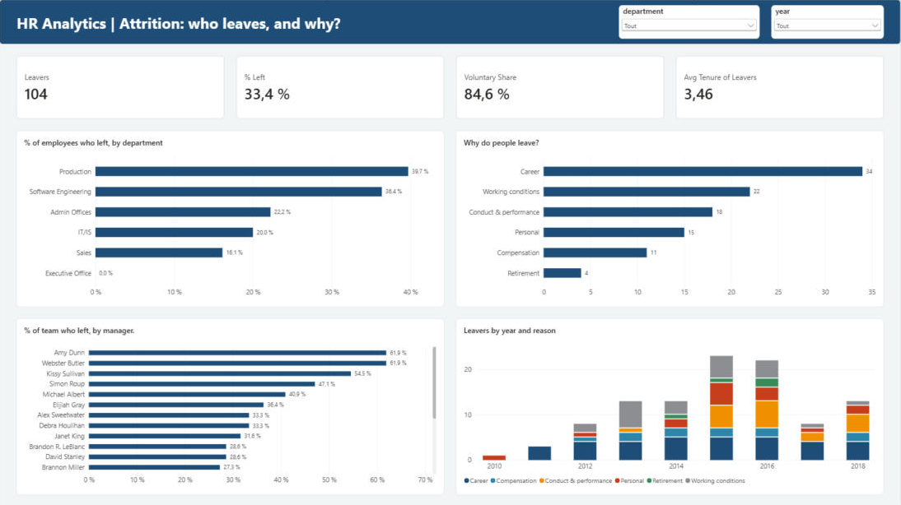
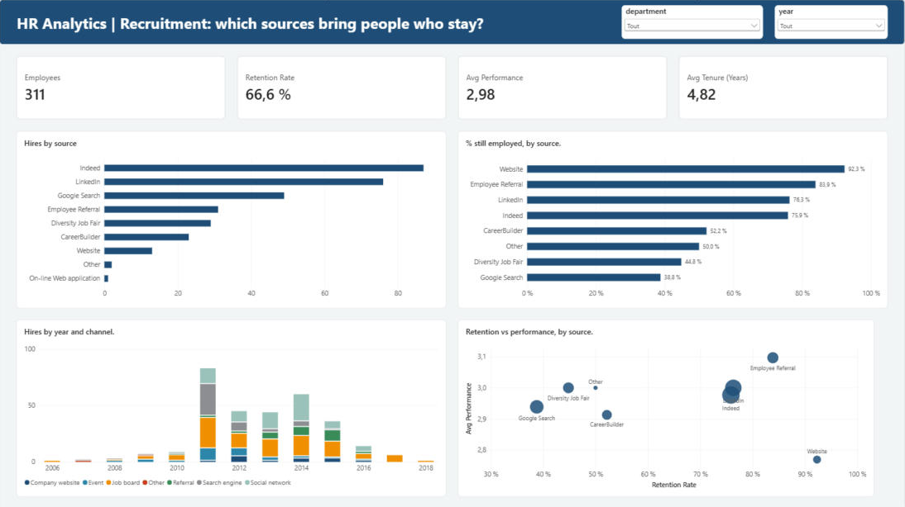
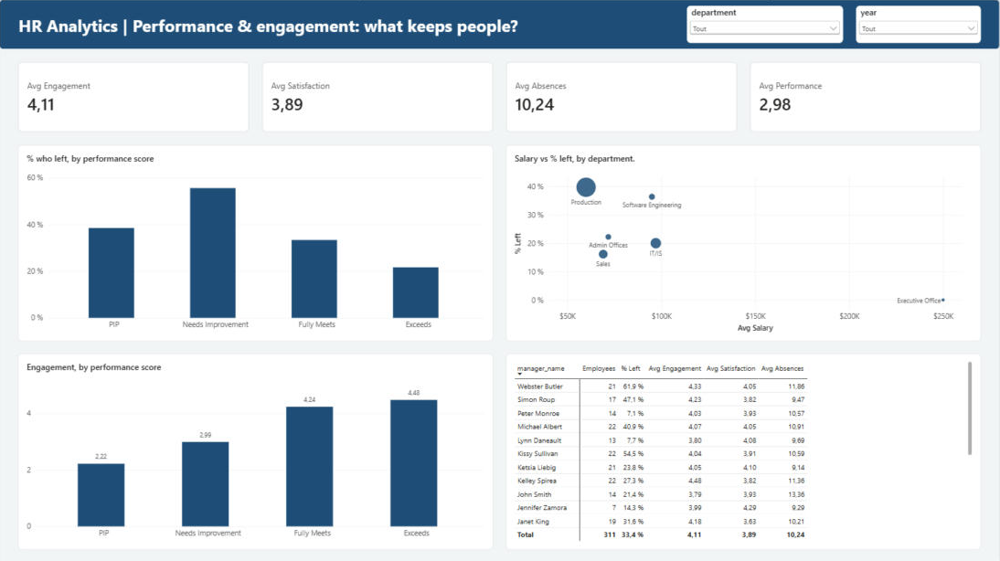
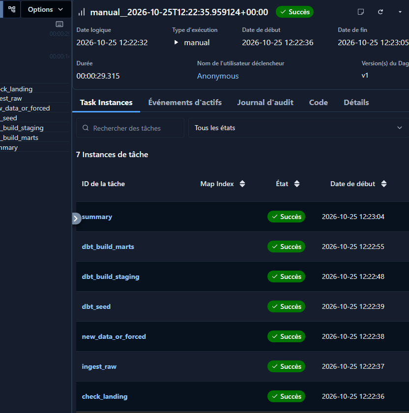

# 🧑‍💼 HR Analytics Pipeline


> End-to-end data pipeline: a raw HR system export goes through **Python ingestion**, **dbt transformations**
> and a **PostgreSQL star schema**, and ends up in a **4-page Power BI dashboard**.
> Orchestrated with **Airflow**, fully reproducible with **Docker**, protected by **91 data tests**.



## Business questions
- How many employees do we have, and how has headcount changed over time?
- Who leaves, why, and from which department or manager?
- Which recruitment source brings employees who stay longer and perform better?
- Are engagement, absences and attrition related?

## Key findings
From the 311 employees in the dataset:

| Question | Finding |
|---|---|
| How many leave? | **104 employees (33%)** have left, and **85% of them left voluntarily**. |
| Why? | **Career reasons** (another position, career change, more money elsewhere...) are the #1 category, about **1 leaver in 3**, followed by working conditions. |
| Where? | **Production** loses about **40%** of its staff, against **16%** in Sales. |
| Which source hires best? | **Employee referrals keep 84%** of their hires. Google Search keeps only 39% and the Diversity Job Fair 45%. |
| Performance link? | **56%** of "Needs Improvement" employees left. Engagement falls from **4.5/5** (Exceeds) to **2.2/5** (PIP). |

**Recommendation:** invest in the referral programme, and look at career paths and working conditions in Production first.

## Architecture

```
HR export (CSV) ─┐
Reference CSVs ──┤  ① Extract + Load (Python)
                 ▼
PostgreSQL:  raw ──② dbt──▶ staging ──▶ marts (star schema) ──③ dbt tests
                                              │
                                              ▼  ④
                                       Power BI dashboard
Airflow orchestrates ①②③ · everything runs in Docker
```

## Power BI dashboard
| Page | What it answers |
|---|---|
| **Overview** | Headcount, hires, terminations, attrition rate and salary over time, by department |
| **Attrition** | Why people leave, which departments and managers lose the most, voluntary vs involuntary |
| **Recruitment** | Hires and retention by source and channel, retention vs performance per source |
| **Performance** | Engagement, satisfaction and absences vs attrition, by performance score and manager |

A **Checks** page reconciles every measure with the warehouse, so the numbers on screen are verified.

| Attrition | Recruitment | Performance |
|---|---|---|
|  |  |  |

File: [`powerbi/HR_Dashboard.pbix`](powerbi/HR_Dashboard.pbix)

## What this project demonstrates
- **Data profiling and cleaning:** [22 data issues found](docs/profiling_report.md), each with a documented [cleaning rule](docs/cleaning_rules.md).
- **Dimensional modeling:** [star schema](docs/data_model.md) with 7 dimensions, 2 fact tables, surrogate keys and a generated calendar.
- **Idempotent ingestion:** a file is loaded once only, with a schema check and all-or-nothing loading.
- **Data quality:** 91 dbt tests, including a reconciliation of the facts with the source data.
- **Orchestration:** monthly Airflow DAG with a quality gate: bad data never reaches the marts, and Power BI keeps the last good data.
- **Reproducibility:** the whole stack starts with one `docker compose` command, no local Python install needed.

## Roadmap
- [x] **0. Setup:** repo structure, Dockerised PostgreSQL warehouse, toolbox container
- [x] **1. Data discovery:** [profiling report](docs/profiling_report.md) (22 issues) and [cleaning rules](docs/cleaning_rules.md)
- [x] **2. Data modeling:** [star schema and data dictionary](docs/data_model.md), reference files
- [x] **3. Extract + Load:** idempotent ingestion into `raw` (schema check, all-or-nothing, 8 tests)
- [x] **4. Transform:** dbt staging + 7 dimensions + 2 facts, 91 data tests (incl. reconciliation with the source)
- [x] **5. Orchestration:** monthly Airflow DAG with a quality gate (bad data never reaches the marts)
- [x] **6. Power BI:** 4-page dashboard + a checks page
- [ ] **Next:** history of department and manager changes (slowly changing dimension type 2), cloud deployment

## Project structure
```
├── data/landing/      # incoming HR exports (source files)
├── data/reference/    # small lookup files (regions, reason categories)
├── ingestion/         # Python: extract + load into raw
├── dbt/               # dbt project: staging, marts, tests
├── dags/              # Airflow DAG
├── powerbi/           # .pbix dashboard
├── sql/init/          # warehouse bootstrap (schemas)
├── scripts/           # helper scripts
├── docs/              # profiling report, data dictionary, screenshots
└── tests/             # Python tests (ingestion, DAG)
```

## Quick start
Requirements: Docker Desktop.
```bash
git clone https://github.com/AYMANETBAIK98/HR-ANALYTICS-PIPELINE.git
cd HR-ANALYTICS-PIPELINE
docker compose up -d                                          # start the warehouse
docker compose run --rm tools python scripts/check_setup.py   # check everything is ready
docker compose run --rm tools python -m ingestion.load_raw    # load data/landing/*.csv into raw
docker compose run --rm tools dbt build                       # seeds + models + data tests
docker compose run --rm tools pytest -v                       # run the Python tests
```

### Run it with Airflow
```bash
docker compose --profile airflow up -d --build     # first time: ~5 min to build the image
```
Open **http://localhost:8081** (use a private window if your browser translates pages), click **hr_pipeline** → **Trigger**.

```
check_landing → ingest_raw → new_data_or_forced? → dbt_seed → dbt_build_staging → dbt_build_marts → summary
```
- No new file since the last run → the dbt tasks are **skipped** (trigger with `force_rebuild = true` to rebuild anyway).
- A cleaning test fails in `dbt_build_staging` → `dbt_build_marts` does **not** run: Power BI keeps the last good data.


*A forced run (`force_rebuild = true`) in Airflow 3: all 7 tasks succeeded in 29 s.*

Warehouse connection (DBeaver, Power BI): host `localhost`, port `5434`, database `hr`, user `hr`, password `hr`.

## Data
[Human Resources Data Set](data/README.md) by Dr. Rich Huebner and Dr. Carla Patalano: a **fictional** dataset
created for teaching HR analytics (311 employees, 36 columns).

## Author
**Ayman Tbaik** · Data Analyst / Data Engineer
[LinkedIn](https://www.linkedin.com/in/ayman-tbaik-324a0a211) · [GitHub](https://github.com/AYMANETBAIK98)

Open to freelance missions: Power BI dashboards, data pipelines, SQL and Python.
