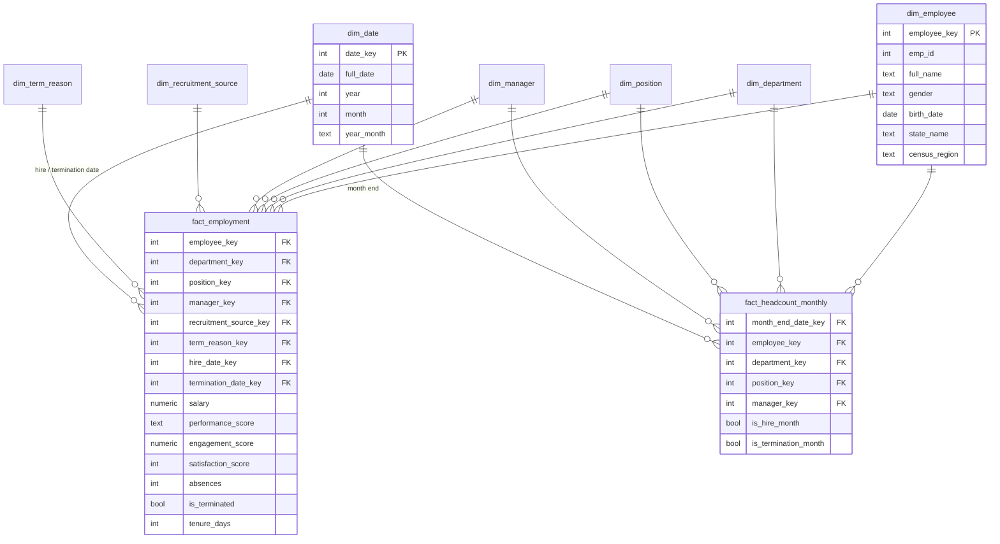

# Data model: star schema (`marts` schema)

The clean data (after the [cleaning rules](cleaning_rules.md)) is organised as a **star schema**:
**fact tables** in the middle hold the events and measures, and **dimension tables** around them
describe the who / what / where / when. Power BI is designed for this shape.

## Design decisions

| Decision | Why |
|---|---|
| **Surrogate keys** (`*_key`, integers generated by the warehouse) | The source codes are unreliable (see cleaning rules), and a key we own never changes meaning. |
| **"Not applicable" member, key `-1`** in `dim_term_reason` | Active employees have no termination reason. Pointing them to `-1` instead of NULL avoids "(Blank)" in Power BI slicers and keeps joins simple. |
| **`dim_date` generated** (2006-01-01 to 2019-12-31) | Power BI time intelligence needs a continuous calendar. It covers every hire, termination and review date. |
| **Two fact tables** | `fact_employment` answers "who, how much, how well" (one row per employee). `fact_headcount_monthly` answers "how many over time". You cannot get a headcount trend from one row per employee without it. |
| **Reference files** in `data/reference/` | Business groupings that do not exist in the source: termination reason → category, recruitment source → channel, state → name + census region. Loaded as dbt **seeds**. |

### Known limitation (stated honestly)
The source is a **snapshot**: it holds each employee's *current* department, position and manager, not their history.
`fact_headcount_monthly` therefore assumes an employee stayed in the same department for their whole tenure.
A real HR system would provide change history, handled with a *slowly changing dimension (type 2)*.

## Grain of each table (what one row means)

| Table | Grain | Rows (expected) |
|---|---|---|
| `fact_employment` | one employee | 311 |
| `fact_headcount_monthly` | one employee × one month-end while employed (up to 2019-02-28) | ~18,000 |
| `dim_employee` | one employee | 311 |
| `dim_department` | one department | 6 |
| `dim_position` | one job title | 32 |
| `dim_manager` | one manager | 21 |
| `dim_recruitment_source` | one recruitment source | 9 |
| `dim_term_reason` | one termination reason + "Not applicable" | 18 |
| `dim_date` | one calendar day | 5,113 |

## Data dictionary

### `fact_employment`
| Column | Type | Description | Source |
|---|---|---|---|
| employee_key | int | → dim_employee | generated |
| department_key | int | → dim_department | `Department` |
| position_key | int | → dim_position | `Position` |
| manager_key | int | → dim_manager | `ManagerName` |
| recruitment_source_key | int | → dim_recruitment_source | `RecruitmentSource` |
| term_reason_key | int | → dim_term_reason, `-1` if still employed | `TermReason` |
| hire_date_key | int | → dim_date (YYYYMMDD) | `DateofHire` |
| termination_date_key | int | → dim_date, NULL if still employed | `DateofTermination` |
| last_review_date_key | int | → dim_date | `LastPerformanceReview_Date` |
| salary | numeric | Annual salary (USD) | `Salary` |
| performance_score | text | Exceeds / Fully Meets / Needs Improvement / PIP | `PerformanceScore` |
| performance_rank | int | 4 = Exceeds … 1 = PIP (for sorting and averages) | derived |
| engagement_score | numeric | Engagement survey result, 1–5 | `EngagementSurvey` |
| satisfaction_score | int | Employee satisfaction, 1–5 | `EmpSatisfaction` |
| special_projects_count | int | Number of special projects | `SpecialProjectsCount` |
| days_late_last_30 | int | Days late in the last 30 days | `DaysLateLast30` |
| absences | int | Number of absences | `Absences` |
| is_terminated | bool | Employee has left | `Termd` |
| termination_type | text | Voluntary / Involuntary / NULL | `EmploymentStatus` |
| tenure_days | int | Hire → termination date, or → as-of date (2019-02-28) if still employed | derived |
| age_at_hire | int | Age in years on hire date | derived |

### `fact_headcount_monthly`
| Column | Type | Description |
|---|---|---|
| month_end_date_key | int | Last day of the month → dim_date |
| employee_key, department_key, position_key, manager_key | int | → dimensions |
| is_hire_month | bool | Employee was hired during this month |
| is_termination_month | bool | Employee left during this month |

### Dimensions
| Table | Columns |
|---|---|
| `dim_employee` | employee_key, emp_id, first_name, last_name, full_name, gender, birth_date, marital_status, citizenship, is_hispanic_latino, race, state_code, state_name, census_region, zip |
| `dim_department` | department_key, department_name |
| `dim_position` | position_key, position_title |
| `dim_manager` | manager_key, manager_name |
| `dim_recruitment_source` | recruitment_source_key, recruitment_source, recruitment_channel |
| `dim_term_reason` | term_reason_key, term_reason, term_reason_category |
| `dim_date` | date_key, full_date, year, quarter, month, month_name, year_month, day_of_week, is_month_end |

## As-of date
The latest date in the source is a performance review on **2019-02-28**, so the data is treated as a snapshot
taken on that day. "Today" for tenure and active headcount is fixed at **2019-02-28** (a constant in the
dbt project), not the real current date. Otherwise every active employee would look 7 years older in tenure.
